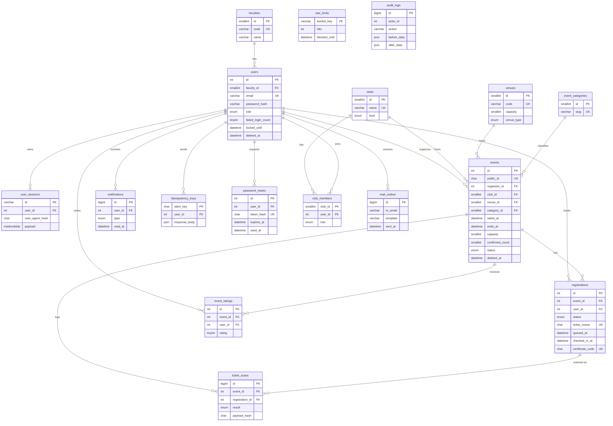

# Entity Relationship Diagram

## Key design decisions

| Decision | Reason |
|---|---|
| `confirmed_count` counter + `CHECK (confirmed_count <= capacity)` | Booking locks one event row (`FOR UPDATE`) instead of counting rows; the CHECK makes overbooking impossible even if application code is wrong |
| Waitlist ordered by `queued_at` (ms precision) | No position numbers to renumber after cancellations |
| One registration row per (event, user) | Re-joining reuses the row; UNIQUE key blocks duplicates |
| QR signature computed, not stored | A database leak cannot be used to forge tickets |
| `public_id` UUID in URLs | Prevents enumerating events by incrementing IDs |
| Triggers re-check lifecycle, capacity and venue clashes | Defence in depth behind the PHP services |
| Audit trigger reads `@app_user_id` / `@app_ip` | Every change records who and from where, with before/after JSON |
| `audit_logs` blocks UPDATE/DELETE | Tamper-evident history |
| No FK on `audit_logs.actor_id` | History survives user deletion |
| Least-privilege DB user | The app account cannot DROP or ALTER tables |
| Events belong to a club, with `club_members` roles | Hosting survives committee turnover; only advisors, presidents and committee members can publish for a club |
| Reset tokens stored as SHA-256 hashes, 30 minute expiry, single use | A database leak cannot be turned into account takeover |
| Every door scan logged, including rejected ones, append-only | Forgery attempts and duplicate entries leave evidence |
| Emails captured in `mail_outbox` | Reset and confirmation flows can be demonstrated without an SMTP server |
| Index column order checked with EXPLAIN ANALYZE | See `docs/PERFORMANCE.md` |

## Verified behaviour (MySQL 8.0.46)

All 19 checks in `scripts/verify_database.sh` pass, including:

| Test | Result |
|---|---|
| Insert event directly as published | Rejected (LIFECYCLE) |
| Event capacity above venue capacity | Rejected (CAPACITY) |
| Submit draft overlapping a booked venue | Rejected (VENUE_CLASH) |
| draft to published, skipping approval | Rejected (LIFECYCLE) |
| Reject without a reason | Rejected |
| Force confirmed_count above capacity | Rejected (CHECK) |
| Delete an audit row | Rejected (AUDIT) |
| Rating by a non-attendee | Rejected (RATING) |
| Reset token that expires before it is created | Rejected (CHECK) |
| Delete a door scan record | Rejected (SCANS) |
| Every check-in has an admitted door scan | Confirmed |
| Approve, soft delete | Allowed, audited with before/after JSON |
| 20 parallel bookings for the last seat | 1 confirmed, 19 waitlisted, count = capacity |
| App DB user runs DROP TABLE | Denied |
