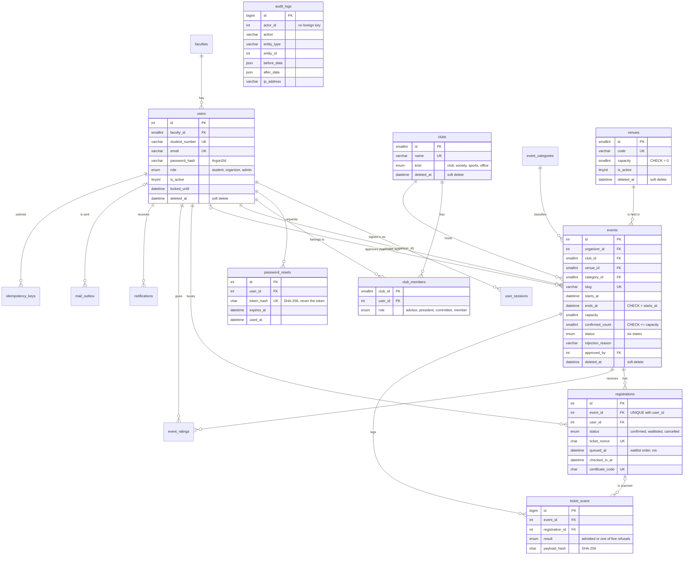

# Data model

Seventeen tables. The diagram shows the relationships; the notes underneath
explain the decisions that are not obvious from the boxes.

Tables not drawn in detail: `faculties`, `event_categories`, `user_sessions`
(session id, user, payload, last activity), `rate_limits` (bucket key, hits,
window start, blocked until), `notifications`, `event_ratings` (rating 1 to 5,
unique per event and user), `idempotency_keys` (key, user, stored response),
`mail_outbox`.

## Decisions in the schema

**`events.confirmed_count` is stored, not counted.** Counting confirmed
registrations on every read would work, but a count cannot be a constraint.
Storing the number lets the rule "never more bookings than seats" be written as
`CHECK (confirmed_count <= capacity)`, which MySQL enforces on every write from
every client. The number is kept true by triggers on `registrations`, not by
PHP, so no code path can forget to update it.

**`audit_logs.actor_id` has no foreign key.** With a foreign key, deleting a
user would either be blocked by their history or would delete or blank it.
Without one, the record of what an account did outlives the account. The audit
page joins to `users` with a LEFT JOIN and shows "Removed account 123" when the
user is gone.

**Events belong to a club, and to a person.** `club_id` decides who may manage
the event (the club's committee, whoever is on it this year). `organizer_id`
records who created it, and is the person who must not approve it.

**One registration row per person per event.** `UNIQUE (event_id, user_id)`
makes a double booking impossible at the lowest level. Cancelling keeps the
row with status `cancelled`; booking again reuses it. Registrations are never
deleted (a trigger refuses), so attendance history and the door log stay intact.

**Soft deletes.** `users`, `events`, `venues` and `clubs` have `deleted_at`.
Rows that other rows and the audit trail point to are hidden, not removed.

**The waitlist has no position column.** Position is derived from
`queued_at` (millisecond precision) and `id`. A stored position number would
have to be renumbered on every cancellation, which is exactly the kind of
update that goes wrong under concurrency.

**Only hashes of secrets are stored.** Passwords as Argon2id. Reset tokens as
SHA-256. Scanned ticket payloads as SHA-256. The ticket signature is not stored
at all: it is recomputed from a key that exists only in `.env`.

## Triggers

| Trigger | Table | What it enforces |
|---|---|---|
| `trg_events_bi` | events | New events start as drafts; organiser is on the club committee; capacity fits the room; venue clash |
| `trg_events_bu` | events | Lifecycle state machine; rejection needs a reason; no self approval; capacity fits the room; venue clash |
| `trg_events_ai`, `trg_events_au` | events | Audit entry with before and after snapshots |
| `trg_registrations_bi` | registrations | Only open events can be booked |
| `trg_registrations_ai`, `trg_registrations_au` | registrations | Maintain `confirmed_count` (which fires the CHECK); audit entry |
| `trg_registrations_bd` | registrations | Bookings are never deleted |
| `trg_users_au` | users | Audit role changes and deactivation |
| `trg_ratings_bi` | event_ratings | Only checked-in attendees of a finished event can rate |
| `trg_audit_no_update`, `trg_audit_no_delete` | audit_logs | Append only |
| `trg_scans_no_update`, `trg_scans_no_delete` | ticket_scans | Append only |
